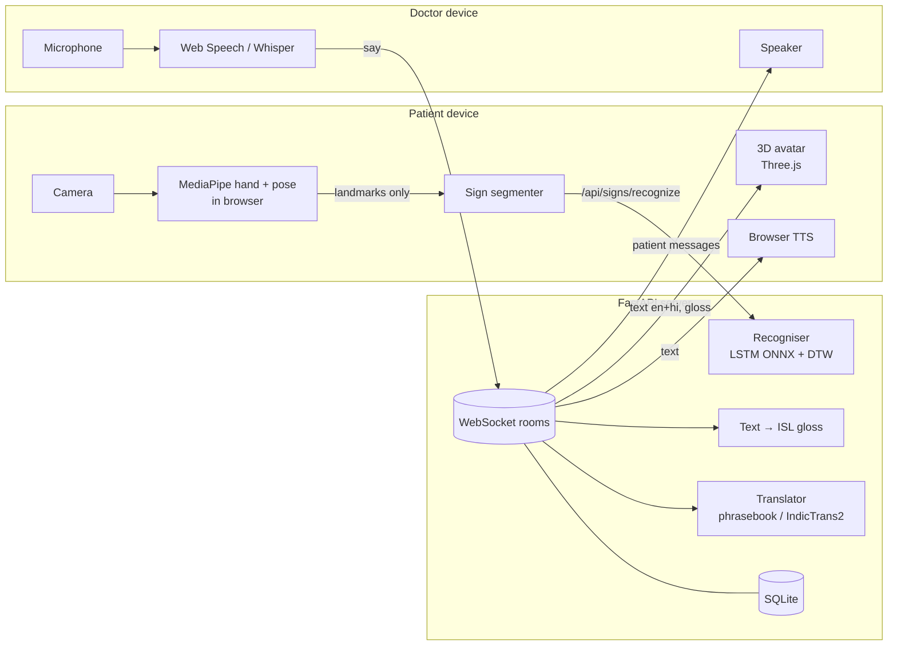

# Arogya · आरोग्य

**A two-way Indian Sign Language and doctor–patient communication assistant.**

Live demo: https://arogya-rgjh.onrender.com (free instance; the first visit after a quiet spell takes about a minute to wake up).

In a hospital, the doctor speaks and a deaf patient sees the words as text and as Indian Sign Language (ISL) signed by a 3D avatar. The patient answers by signing to the camera, tapping symptom pictures, marking pain on a body map or typing, and the doctor hears it in Hindi or English. Blind patients hear every message and get prescriptions read aloud.

Arogya merges two ideas: **SanketSetu** (ISL ⇄ text/speech) and **MediBridge** (accessible doctor–patient communication).

---

## What it does

| For | Feature |
|---|---|
| Deaf / hard-of-hearing patients | Doctor's speech appears as text **and** is signed by a 3D avatar in ISL word order. Patient replies by signing to the camera, with symptom pictures, a pain scale and body map, or by typing. |
| Blind / low-vision patients | Every doctor message is read aloud automatically. One big “tap and speak” button, large Yes/No buttons, and prescriptions that read themselves aloud. |
| Patients who cannot speak | Picture-based symptom board (30 symptoms, Hindi + English), pain 0–10 with body map, quick replies. |
| Doctors | Speak or type in English or Hindi; 30 clinic quick phrases; patient messages read aloud; red-flag symptoms highlighted; structured prescriptions sent to the patient's phone. |
| Everyone | Hindi and English everywhere, text size up to XL, high contrast, dark mode, reduced motion, left-handed signing, installable app (PWA). |
| Anyone signing differently | **Teach a sign**: record your own version of any word; recognition adapts instantly and the avatar signs it your way. |

## Tech stack

| Layer | Technology | Why |
|---|---|---|
| Frontend | React 18, Vite, React Router, plain CSS (no UI kit) | Small, fast, one codebase for laptop and phone (PWA) |
| 3D avatar | Three.js, procedural hand model + two-bone IK | No rigged model files; any landmark source can drive it |
| Hand/pose tracking | MediaPipe Tasks (hand + pose landmarkers) **in the browser** | Video never leaves the device; GPU-accelerated |
| Sign recognition | LSTM (Keras → ONNX) trained on **INCLUDE** + DTW few-shot templates | Works on day one, improves with training and with user recordings |
| Backend | Python 3.11, FastAPI, WebSockets, SQLite, JWT, PBKDF2 | Simple, typed, async real-time rooms |
| Speech | Browser Web Speech API; optional **Whisper** (faster-whisper) and **gTTS** on the server | Works offline-ish, better with server models |
| Translation | Medical phrasebook → optional **IndicTrans2** / MarianMT → marked word-by-word fallback | Accurate where it matters, honest where it is not |
| Text → ISL | Rule-based gloss: drop function words, time first, SOV, negation and question words last | Explainable, testable, safe in a medical setting |
| DevOps | Docker (multi-stage), GitHub Actions (tests, build, Playwright E2E), Render | Free, one URL, auto-deploy on push |

## Architecture



Every message in a consultation is stored once and delivered with **both languages and the ISL gloss**, so each screen shows what its user needs.

More detail: [docs/ARCHITECTURE.md](docs/ARCHITECTURE.md)

## Run it locally

**Option A: Docker (one command)**

```bash
docker compose up --build
# open http://localhost:8000
```

**Option B: for development**

```bash
# 1. API
cd backend
python -m venv .venv && source .venv/bin/activate      # Windows: .venv\Scripts\activate
pip install -r requirements.txt
uvicorn app.main:app --reload --port 8000              # API docs at http://localhost:8000/docs

# 2. Web app (second terminal)
cd frontend
npm install
npm run dev                                            # http://localhost:5173
```

**Demo doctor account:** `demo@arogya.in` / `arogya123` (or press “Try the demo doctor account”).

**Try a consultation:** open the clinic in one browser window, start a consultation, then open the patient link (`/join/CODE`) on your phone or in a private window.

Optional server AI (Whisper, gTTS, neural translation):

```bash
pip install -r requirements-ml.txt
export AROGYA_ENABLE_WHISPER=1 AROGYA_ENABLE_SERVER_TTS=1 AROGYA_TRANSLATION_ENGINE=auto
```

## Train the sign recogniser

The app ships with **85 built-in clinic signs** used both by the avatar and as starter recognition templates, so it works before any training. To add the LSTM trained on the INCLUDE dataset (263 ISL words, AI4Bharat):

1. Open [`ml/Arogya_Train_ISL.ipynb`](ml/Arogya_Train_ISL.ipynb) in Google Colab (free T4 GPU).
2. Run all cells: it downloads INCLUDE, extracts keypoints with MediaPipe, trains, and exports `isl_lstm.onnx` + `labels.json`.
3. Put both files in `backend/app/data/models/` and push. `/api/health` will report `sign_model: true`.

Scripts: [`ml/extract_keypoints.py`](ml/extract_keypoints.py), [`ml/train_lstm.py`](ml/train_lstm.py).

## Tests

```bash
cd backend && python -m pytest -q          # gloss, translation, features, recognition, API + WebSocket flow
cd frontend && npm test                    # landmark maths (checked against Python), avatar, segmenter
cd frontend && npx playwright test         # full doctor ↔ patient consultation in two real browsers
```

CI runs all three on every push and uploads screenshots of each screen.

## Deploy

Runs on Render's free plan from `render.yaml`: see [docs/DEPLOY.md](docs/DEPLOY.md).

## Project structure

```
backend/
  app/main.py              FastAPI app, health, serves the React build
  app/routers/             auth, consultations (+ WebSocket), language, signs, speech, prescriptions
  app/services/            gloss, translator, features, recognizer, rooms, speech, prescription_text
  app/data/                ISL lexicon, phrasebook, symptoms, starter sign templates, trained models
  tests/                   pytest suite
frontend/
  src/avatar/              hand model, ISL sign library, sequencer, Three.js renderer
  src/lib/                 API client, MediaPipe tracker, landmark maths, segmenter, speech, settings
  src/pages/               Home, Sign→Speech, Speech→Sign, Teach, Clinic, Doctor room, Patient room, Prescription
  e2e/                     Playwright tests
ml/                        INCLUDE keypoint extraction, LSTM training, Colab notebook
scripts/                   export_starter_templates.mjs
docs/                      architecture, deployment, interview Q&A
```

## Limitations

- **Not a replacement for a certified ISL interpreter** for consent, surgery or serious diagnoses. The app says so on the home screen.
- Built-in avatar signs are **simplified approximations** of common ISL forms and should be reviewed with Deaf ISL users; any sign can be replaced by a real recording from the Teach screen, and recordings take priority.
- Recognition accuracy depends on lighting, camera angle and signer. Starter templates are synthetic; real accuracy needs the INCLUDE-trained model and/or a few recordings per user.
- ISL also uses facial expression and space; the avatar shows only basic expressions (questions, pain).
- Free hosting keeps data only until the container restarts; use a persistent volume or Postgres for real use.

## Credits

- **INCLUDE** dataset: Sridhar, A., Ganesan, R. G., Kumar, P., Khapra, M. (2020). *INCLUDE: A Large Scale Dataset for Indian Sign Language Recognition.* ACM Multimedia. AI4Bharat.
- **IndicTrans2**: AI4Bharat. **MediaPipe**: Google. **Whisper**: OpenAI (via faster-whisper).
- Font: Anek Devanagari by Ek Type.

## Licence

MIT. See [LICENSE](LICENSE).
