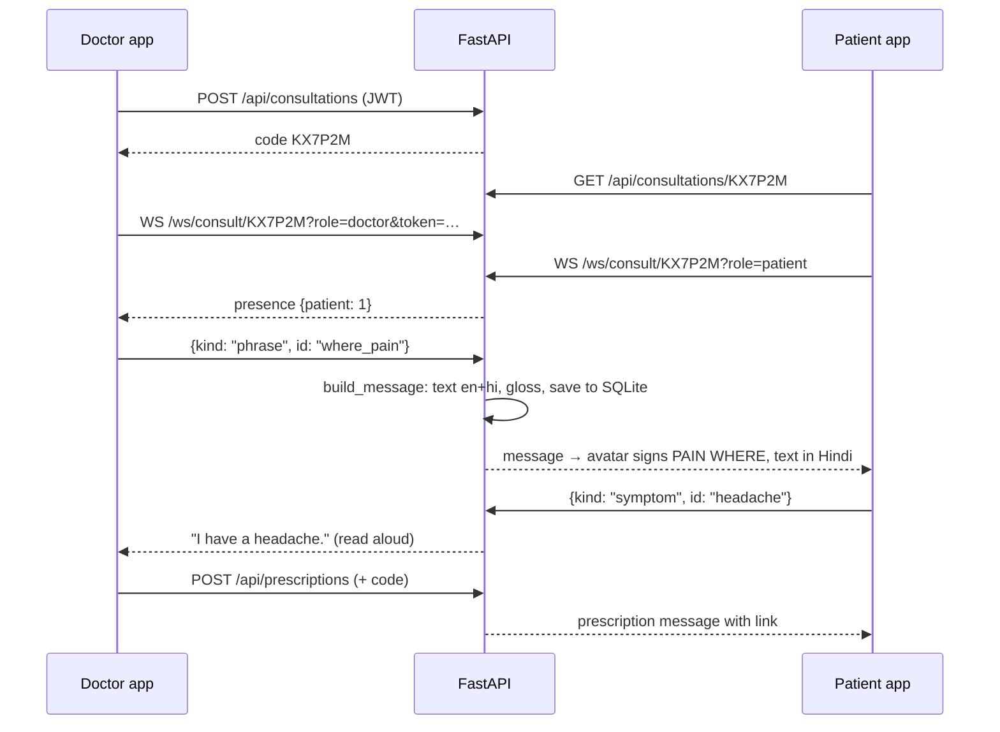

# Arogya architecture

## 1. One data format for everything

The design decision that holds the project together: **a single landmark frame format** is used by the camera, the recogniser, the training pipeline and the avatar.

```json
{ "p": [[x,y,z] × 6],      // L shoulder, R shoulder, L elbow, R elbow, L wrist, R wrist
  "l": [[x,y,z] × 21] | null,  // signer's left hand, MediaPipe hand order
  "r": [[x,y,z] × 21] | null } // signer's right hand
```

Coordinates are centred on the mid-point of the shoulders and divided by shoulder width (+x viewer's right, +y up, +z towards the camera). So a sign gives the same numbers whether the person sits near or far, left or right in the frame.

Because of this:

- a sign recorded on the Teach screen is instantly a **recognition template** *and* an **avatar animation**;
- the avatar's built-in signs are exported as **starter templates** (`scripts/export_starter_templates.mjs`), so recognition works before any training;
- the LSTM trained on INCLUDE sees exactly what the browser sends.

The maths lives in `backend/app/services/features.py` and its line-for-line twin `frontend/src/lib/landmarks.js`. A test (`landmarks.test.js`) loads a fixture produced by the Python code and checks the JavaScript gives the same numbers.

## 2. Sign → text (patient signs)

```
camera ──► MediaPipe hand + pose (browser, ~20 fps)
       ──► assign hands by nearest pose wrist (robust to mirroring)
       ──► normalize (shoulder frame)
       ──► SignSegmenter: start when a wrist rises above the waist, end after ~7 rest frames
       ──► POST /api/signs/recognize { frames }
               ├─ LSTM (ONNX): 30 frames × 144 features → softmax over INCLUDE classes
               └─ DTW templates: 24 frames × 38 compact features, also tried mirrored (left-handers)
       ──► merge, rank; "confident" if top score ≥ 0.45, otherwise the patient picks from the top 3
```

**Why two recognisers.** The LSTM covers a large vocabulary once trained (needs a GPU once). DTW nearest-neighbour needs no training, works with one recording, and adapts to regional variants and to individual users. Users' own recordings get a small bonus over starter templates.

**Compact DTW features (38-d):** for each hand, wrist position (3), five fingertip positions relative to the wrist divided by palm size (15), and a present flag (1). Position says *where* the sign is made, fingertips say *which handshape*.

**Privacy:** only ~150 numbers per frame are sent, never video.

## 3. Text/speech → sign (doctor speaks)

```
mic ──► Web Speech API (Chrome/Edge/Android) or Whisper on the server
    ──► WebSocket "say" { text, lang }
    ──► server: translate to the other language + text_to_gloss(text)
    ──► every screen gets { text: {en, hi}, gloss: [...], approximate, engine }
    ──► patient screen: big text in their language + avatar signs the gloss
```

**Gloss rules** (`services/gloss.py`), in order:

1. Greedy longest-match of multi-word phrases (“thank you” → THANK-YOU, “after food” → FOOD AFTER).
2. Drop function words (a, the, is, to, को, का, है …).
3. Map words to canonical signs with a synonym table (hurts, ache, दर्द → PAIN), with a small lemmatiser for English.
4. Unknown words are fingerspelled; Hindi names are transliterated first (रवि → RAVI).
5. Reorder: **time words first**, then subject/object, then **verbs**, then **negation**, then **question words**. This matches ISL's verb-final order and its question-word-at-the-end pattern.

Example: “Where does it hurt?” → `PAIN WHERE`; “I did not sleep at night” → `NIGHT ME SLEEP NOT`; “खाने के बाद दवा लीजिए” → `FOOD AFTER MEDICINE TAKE`.

## 4. The avatar

`frontend/src/avatar/`

- **handModel.js**: a hand pose is described as a signer would describe it: *where the wrist is*, *which way the fingers point*, *which way the palm faces*, and a *handshape* (per-finger curl + spread). From that it computes all 21 MediaPipe hand points. Elbows come from two-bone inverse kinematics with a pole vector that swings forward as the hand rises, like a real arm.
- **signs.js**: 85 clinic signs as short keyframe lists, plus fingerspelling. ISL vowels use the real ISL form (right index touching a fingertip of the open left hand).
- **sequencer.js**: tokens → timeline (rest → sign → transition → sign → rest), smoothstep interpolation of positions, directions and finger curls; recorded signs override built-ins.
- **AvatarRenderer.js**: Three.js scene built from primitives (lathe kurta, spheres, cylinders). Each frame it places every bone between two landmarks. Face: eyebrows raise for questions, furrow for pain; blinking; head nods for YES/HELLO and shakes for NO/NOT. OrbitControls let the patient turn the avatar to see a handshape from the side.

## 5. Consultation flow



Message kinds: `say`, `phrase`, `symptom`, `pain`, `sign`, `prescription`. All are validated in `services/consult.py`, which is framework-free and unit-tested directly. Red-flag symptoms (chest pain, bleeding, breathlessness) and pain ≥ 8 are marked urgent.

**Scaling note:** rooms are an in-memory dict, fine for one server process. For several instances, replace `RoomManager` with Redis pub/sub (same interface).

## 6. Prescriptions

Stored as **structured fields** (medicine, strength, morning/afternoon/night quantity, before/after food, days), never free text. That gives:

- exact Hindi and English sentences with no machine translation (`services/prescription_text.py`);
- a pictorial schedule (sun / midday sun / moon);
- an ISL gloss of the schedule so the avatar can sign it;
- a public link (`/rx/<14-char token>`) the patient opens on their own phone, printable.

## 7. Security

| Concern | Measure |
|---|---|
| Passwords | PBKDF2-HMAC-SHA256, 200,000 rounds, random salt, constant-time compare |
| Doctor API | JWT (HS256, 12 h expiry), secret from `AROGYA_SECRET_KEY` |
| Doctor WebSocket | Token checked and must belong to the consultation's doctor |
| Patient access | 6-character room code from a 31-symbol alphabet without look-alikes (~887 million combinations); rooms close when the doctor ends them |
| Prescriptions | Unguessable 14-character link token (~83 bits) |
| Input | Pydantic schemas with length limits on every field; frames capped at 240 |
| Video | Never uploaded; landmarks only |

## 8. Optional AI on the server

| Env var | Effect |
|---|---|
| `AROGYA_ENABLE_WHISPER=1` | `/api/speech/stt` transcribes with faster-whisper (`base`, int8, CPU) |
| `AROGYA_ENABLE_SERVER_TTS=1` | `/api/speech/tts` returns gTTS MP3 (Indian English/Hindi), LRU-cached |
| `AROGYA_TRANSLATION_ENGINE` | `phrasebook`, `marian`, `indictrans2` or `auto` |
| `AROGYA_SIGN_MODEL` | path to the ONNX model (default `app/data/models/isl_lstm.onnx`) |

The app works with all of them off; the browser provides speech, and the phrasebook covers clinic talk.
